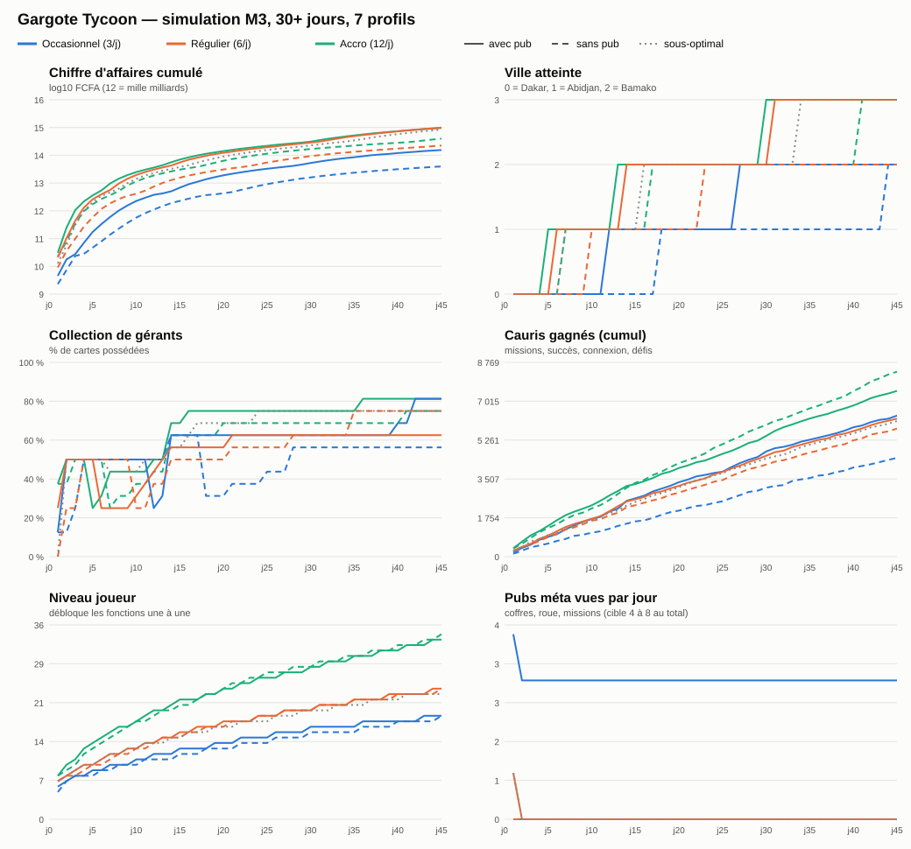

# M3 — Méta : rapport

## État

M3 est complet : contenu, tests, simulation et mesures sur l'A23. Pas d'assets finaux, pas de pub ni d'achat réels
(services MOCK jusqu'à M5), pas d'événements live ops. Rien n'est commité.

| Vérification | Résultat |
|---|---|
| Tests EditMode | **154/154** verts (logique méta, sauvegarde, migrations, tirages déterministes, pitié, missions, série, horloge) |
| Tests PlayMode | **10/10** verts : relancer puis voyager, coffre gratuit, missions, **chaque écran < 150 ms**, **zones d'UI sans chevauchement dans 10 situations**, rue figée et carte dans l'écran pour chaque fenêtre |
| Simulation 30+ jours, 7 profils | **199/199** contrôles OK (`Tools/simulation/last_run.txt`) |
| Démarrage à froid A23 (APK release) | **2,22 s** médiane (2,14 à 2,69 s), cible < 3 s |
| Mémoire A23 | **278 Mo** PSS en release (360 Mo en build de développement), cible < 450 Mo |

## Contenu livré

- **Prestige** : écran « Ouvrir une nouvelle ville » avec « Pas encore », **Relancer** (rejouer la ville, étoiles) et
  **Voyager** (ville suivante) distincts ; cinématique de 5 s passable après 1 s ; villes visitées consultables avec
  revenu passif réduit.
- **Upgrades** : 40 upgrades FCFA par ville et upgrades d'étoiles, badge NOUVEAU et points rouges.
- **Gérants** : 32 gérants (Commun à Légendaire), boost actif avec recharge, bonus passif, niveaux 1 à 10 par cartes.
- **Coffres** : bois, bronze, or, Teranga ; bouton « i » (chances affichées) ; pitié ; doublon au niveau max converti en
  cauris ; tirage déterministe ; coffre gratuit toutes les 4 h, 2 en réserve.
- **Quotidien** : 3 missions actives (un changement gratuit par jour puis rewarded, bouton x2), connexion 7 jours, série
  avec bouclier, roue (1 tour gratuit + 3 rewarded), défis du jour.
- **Collection** : album de 22 recettes (anecdote + recette réelle courte), 62 succès à paliers, niveau joueur qui
  dévoile les fonctions une à une (clic sur le niveau = prochaine fonction).
- **Réglages** : notifications, musique, sons, effets réduits, qualité (Auto / Bas / Moyen / Haut). Demande de
  notification douce après le premier coffre, jamais au premier lancement.
- **Notifications locales** : 2 par jour maximum, jamais entre 22 h et 8 h, désactivables.
- **Horloge** : recul d'horloge toléré 5 min (synchro réseau) ; au-delà, l'absence vaut 0 et rien n'est réclamable
  jusqu'au vrai jour suivant, sans message ni pénalité (le jour revient tout seul).
- **UI** : onglets Rue / Gérants / Upgrades / Villes / Boutique, tout le texte en FR/EN dans les tables de localisation.

## Simulation (`Tools/simulation/charts/m3_meta.svg`)

Profil de référence (régulier avec pub) : 1er prestige possible **jour 1,54**, Abidjan **jour 6,75**, Bamako
**jour 14,4**, collection **62,5 %** à J30, plus longue attente sans objectif **15 min** (cible ≤ 30), 8 rewarded par jour.

| Profil | 1er prestige | Abidjan | Bamako | Collection J30 | Rewarded / jour |
|---|---|---|---|---|---|
| Occasionnel avec pub | j1,75 | j12,8 | j27,8 | 62,5 % | 8 |
| Occasionnel sans pub | j2,33 | j18,8 | j44,8 | 56,3 % | 0 |
| Régulier avec pub | j1,54 | j6,75 | j14,4 | 62,5 % | 8 |
| Régulier sans pub | j1,65 | j10,3 | j23,3 | 56,3 % | 0 |
| Accro avec pub | j1,49 | j6,33 | j13,3 | 68,8 % | **14** |
| Accro sans pub | j1,54 | j7,91 | j17,9 | 68,8 % | 0 |
| Sous-optimal | j1,54 | j7,33 | j16,3 | 75 % | 7,8 |

À surveiller :
- **Rewarded accro = 14 par jour**, au-dessus de la fourchette indicative 4 à 8 (non bloquant, le minimum est atteint) :
  à plafonner par placement en M5 si les KPIs montrent de la lassitude.
- La collection **baisse** à chaque nouvelle ville (le nombre de gérants disponibles passe de 16 à 32) : voulu, mais
  l'album doit l'expliquer (« Nouveaux gérants à Abidjan ! »).
- Rééquilibrage M3 : coffre or `{83,1 / 15 / 1,5 / 0,4}` avec pitié tous les 14 coffres, coffre Teranga `{59 / 35 / 3 / 3}`,
  objectif cumulé d'Abidjan porté à 3,4e13 FCFA.

## Performance — Samsung Galaxy A23 (SM-A235F, Snapdragon 680, 4 Go, 90 Hz)

### Démarrage à froid (`Tools/perf/m3/release/runs.txt`)

| Build | Médiane | Avant Unity | Unity → Awake | Awake → rue jouable |
|---|---|---|---|---|
| Dev, splash Unity (avant) | 5,1 s | 1,6 s | 2,2 s | 0,9 s |
| **Release, sans splash (après)** | **2,22 s** | 1,0 s | 0,13 s | 0,83 s |

Cause : l'écran « Made with Unity » (animation Dolly, environ 2 s) était actif. Il est coupé dans `AndroidBuild`
(optionnel sur tous les plans depuis Unity 6). La mesure release passe par le define `GARGOTE_PROBE` (menu
*Gargote / M3 / Build release APK (mesure démarrage)*). APK release : **40 Mo** (dev : 73 Mo), cible < 80 Mo.

Notre code pèse 0,83 s (localisation 0,12 s, données 0,30 s, construction de la rue et de l'UI 0,40 s). Piste si la
cible se resserre : construire les écrans méta à la première ouverture plutôt qu'au démarrage.

### Écrans méta sur téléphone

Scénario automatique sur le téléphone (APK de développement, extra `gargoteCaptureMeta`, script
`CaptureDirectorMeta.cs`) : 18 captures dans `Tools/screenshots/m3/a23/`, mesures dans `perf_m3.txt`. Qualité
détectée : Moyen. Chaque écran est ouvert sur la rue en jeu, puis mesuré pendant 3 s.

| Écran | Ouverture (cible < 150 ms) | FPS écran ouvert (avant → après rue figée) |
|---|---|---|
| Missions | 7,6 ms | 49,9 → **59,9** |
| Coffre (ouverture) | 0,9 ms | 59,9 → **59,9** |
| Chances du coffre | 1,5 ms | 59,9 → **59,9** |
| Connexion 7 jours | 6,2 ms | 56,9 → **59,9** |
| Roue Teranga | 2,3 ms | 51,9 → **59,8** |
| Gérants | 26,0 ms | 40,2 → **55,5** (un pic isolé de 100 ms) |
| Détail gérant | 3,1 ms | 57,8 → **59,9** |
| Album | 13,1 ms | 44,6 → **59,7** |
| Succès | 62,9 ms | 43,9 → **59,9** |
| Upgrades | 32,2 ms | 44,5 → **59,9** |
| Villes | 3,2 ms | 52,2 → **59,8** |
| Boutique | 8,3 ms | 44,6 → **59,8** |
| Réglages | 5,1 ms | 50,2 → **59,8** |
| Prestige | 1,5 ms | 59,9 → **59,9** |

Captures : `m3_01_debut_niveau1` (partie neuve), `m3_02_rue_rails_remplis` (toutes fonctions), `m3_03` à `m3_15`
(un écran chacune), `m3_16_prestige_voyage`, `m3_17_cinematique_voyage`, `m3_18_arrivee_abidjan`.

Reste connu : le pic isolé de 100 ms sur l'écran Gérants (32 cartes) n'est pas expliqué ; à profiler en M4 quand les
portraits remplaceront les cercles.

## Corrections d'UI faites pendant la vérification

- **Voile des fenêtres trop clair** : le projet est en espace couleur Linear, l'alpha de l'UI se mélange en linéaire ;
  un noir à 62 % ne retirait que 35 % de luminosité perçue (barre x1 / « Acheter le meilleur » restée vive). Voile à
  85 %, réglable dans `HudConfig.modalVeil`. Les fenêtres sont désormais opaques (une fenêtre empilée ne transparaît plus).
- **Badge NOUVEAU** placé au-dessus du bouton : il ne chevauche plus les noms d'upgrade longs.
- **Écran Villes** : hauteur ajustée au nombre de villes, « Tu es ici » à côté du nom.
- **Écran 20:9 (A23, 1080×2408)** : l'UI n'y dispose que d'environ 964 unités de large ; les fenêtres de 1000 à 1040
  débordaient (bouton X coupé) et la pastille cauris recouvrait le montant d'argent. Les fenêtres sont désormais réduites
  à l'ouverture pour tenir dans l'écran ; la pastille argent s'étire entre le niveau et les cauris, et le montant réduit
  sa taille plutôt que de déborder.
- **FPS avec une fenêtre ouverte** : 45 au lieu de 60 sur l'A23. Mesure : rue 3D seule 60, fenêtre seule 60, les deux
  45 (dépassement du budget GPU de l'Adreno 610). Correctif : à l'ouverture d'une fenêtre, la rue est rendue une fois
  dans une texture demi-résolution affichée sous le voile, et la caméra 3D est coupée jusqu'à la fermeture. Le HUD, les
  montants et la simulation restent vivants ; seule l'image de la rue, assombrie à 85 %, ne bouge plus.
- **Arrivée dans une nouvelle ville** : le panneau gardait les noms de Dakar (« Forokh Thiaya » à Abidjan) et le bandeau
  affichait « Objectif Dakar » avec le montant d'Abidjan. Les deux suivent maintenant la ville courante (test PlayMode
  du voyage étendu). La rue garde les placeholders de Dakar : l'habillage d'Abidjan est prévu en M6.
- **Changement de mission** sans alternative : la mission est gardée et rien n'est facturé (régression testée).
- **Toast** calé entre les rails ; tween du panneau lié à son objet (plus d'erreur à la destruction de la scène).

## À fournir avant M4

1. **Relecture culturelle** de `docs/CULTURE_REVIEW.md`, section M3 : 32 gérants, 22 recettes (anecdotes et étapes),
   62 succès. Premiers points tranchés et appliqués : Badara le lève-tôt, Tonton Braise, Pape du café Touba conservé,
   Tata Bissap et « Jus de gingembre & bissap » (aucun alcool), Plateau Salé, Kiki Traiteur, assiette de Gargote à
   2 000 FCFA (revenu/s inchangé, simulation 199/199). Restent : noms wolof marqués « (à valider) », Forokh Thiaya /
   Tangana / Maïga à confirmer, vérifier que « Kiki Traiteur » n'est pas une entreprise réelle.
2. **Validation des captures** de ce rapport (ordre des onglets, lisibilité, place des rails) : elles servent de base
   à l'UI finale de M4.
3. **Décision sur les rewarded du profil accro** (14 par jour) : garder, ou plafonner par placement.
4. Pour M4 (déjà demandé en M2) : pack d'assets low-poly et sa licence, police définitive, musiques jour/nuit, sabar,
   voix courtes des gérants, photos de référence des rues de Dakar.
5. Optionnel : mettre à jour le pilote graphique Intel du PC (l'éditeur doit sinon être lancé avec `-force-d3d12`).
